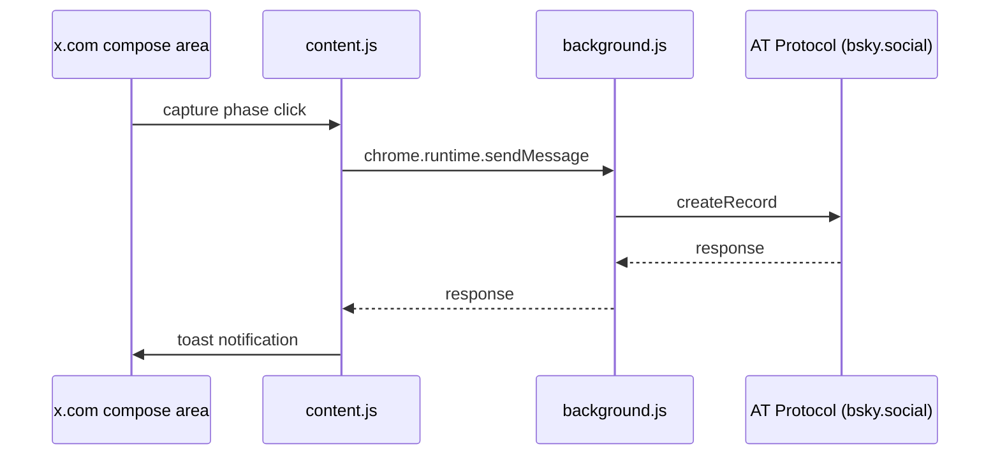

# CLAUDE.md — X to Bluesky Crossposter

## プロジェクト概要

X (Twitter) の投稿ボタンをフックし、同じテキストを Bluesky に同時投稿する Chrome 拡張 (Manifest V3)。
外部依存ゼロ、全ファイル自作。API キー不要（X 側は DOM フック、Bluesky 側は AT Protocol 直接通信）。

## リポジトリ構成

```
x-to-bsky/
├── manifest.json        # Manifest V3 設定
├── background.js        # Service worker: Bluesky API (認証・投稿・画像・スレッド)
├── lib.js               # 純粋関数 (grapheme処理・テキスト分割・facet解析・URL検出・URL省略)
├── shared.js            # content.js / options.js / popup.js 共有の定数とアイコン (DEFAULT_SELECTORS・createIcon・renderIcons)
├── content.js           # x.com 上のコンテンツスクリプト (投稿・画像・スレッドフック)
├── content.css          # トースト通知・バッジ・アイコンのスタイル
├── popup.html           # ツールバーポップアップ UI
├── popup.js             # ポップアップロジック (トグル ON/OFF)
├── options.html         # 設定画面 UI (認証・セレクタ設定)
├── options.js           # 設定ロジック (認証・セレクタ・i18n)
├── icons/               # 16/48/128px PNG
├── _locales/            # 拡張名・説明の ja / en メッセージ (manifest.json の __MSG_*__)
├── .github/workflows/   # GitHub Actions ワークフロー
├── build.sh             # zip パッケージング
├── test/lib.test.js     # Vitest 単体テスト (lib.js)
├── test/icons.test.js   # Vitest: UI ファイルに絵文字が無く、使うアイコン名が shared.js にあること
├── test/release.test.js # Vitest: Release / Tag release ワークフローの構成と tools/ のスクリプト
├── tools/check-tag.sh   # Release: タグ上の run かどうかとタグ名からリリースの可否を判定
├── tools/tag-plan.sh    # Tag release: master の commit が版を動かしたときに付けるタグを出力
├── tools/verify-version.sh # Release: タグと manifest.json の version / version_name の一致確認
├── package.json         # dev dependencies (vitest)
├── docs/security-audit.md # セキュリティ監査レポート
├── PRIVACY_POLICY.md    # プライバシーポリシー (EN。JA は PRIVACY_POLICY_JA.md)
├── README.md            # セットアップ手順・仕様説明
└── CLAUDE.md            # このファイル
```

## アーキテクチャ

### データフロー



### content.js

- `document.addEventListener("click", handler, true)` で capture phase フック
- セレクタはデフォルト定義 + `chrome.storage.local.customSelectors` で上書き可能
- テキスト抽出: `tweetTextarea_${n}` を 0 からインクリメントしてスレッド全体を取得
- 画像抽出: textarea 近傍の `` を canvas 経由で base64 キャプチャ (同期処理)。`object-fit: cover` の画像は `getVisibleRect()` で表示領域のみをクロップしてキャプチャ。キャプチャ結果に `width`/`height` を含め、AT Protocol `aspectRatio` フィールドとして Bluesky に送信
- フォールバック: `.DraftEditor-root [data-text="true"]`
- リプライ判定: `isReplyContext()` で既存ポストへの返信かを検出 (モーダルは返信先ツイート `[data-testid="tweet"]` の有無で判定、引用 RT は除外。`/status/` ページのインライン compose は返信とみなす)。`postReplies` が OFF (デフォルト) の場合は返信をクロスポストしない
- 投稿ボタンに蝶の SVG アイコン (`createIcon("butterfly")`) のバッジを MutationObserver で動的付与。クロスポストが ON かつ認証設定済みのときだけ表示し、`crosspostEnabled` / `bskyHandle` / `customSelectors` の変更時に既存ボタンのバッジも付け外しする
- トースト通知で Bluesky 投稿結果を表示 (成功: 青 + チェックの SVG アイコン, 失敗: 赤, スレッド件数表示)
- 初期状態読み込み: `chrome.storage.local.get` で直接読み込み (SW 起動不要)。`storage.onChanged` で全設定をリアルタイム同期
- Service worker 起動: `sendMessageWithWakeup()` で `GET_STATUS` ping 後に本メッセージ送信。1秒タイムアウトのフォールバック付き。非冪等メッセージはリトライしない
- 拡張コンテキスト無効化ガード: `chrome.runtime?.id` チェックでリロード後のサイレント失敗を防止

### background.js

- `createSession()`: 認証 + セッションキャッシュ。401 時の明確なエラーメッセージ
- `resolveMentionFacets()`: メンション handle → DID 解決
- `uploadImage(base64Data, mimeType, accessJwt)`: `com.atproto.repo.uploadBlob` で画像アップロード
- `fetchOgpMetadata(url)`: 任意 URL から OGP メタデータ取得 (head のみストリーム読み取り)
- `uploadThumbnail(imageUrl, accessJwt)`: 画像 URL をダウンロードして Bluesky にアップロード。1MB 超の画像は `downscaleToJpeg` で縮小してから送信 (Bluesky lexicon の `embed.external.thumb` 上限が 1,000,000 バイトのため)
- `downscaleToJpeg(buf, contentType)`: `createImageBitmap` + `OffscreenCanvas` + `convertToBlob` で 1000px 以下にリサイズ + JPEG 再エンコード (quality 0.85→0.4 と段階的に低下)。Service Worker でも動作。1MB に収まらない場合は null を返しサムネイルなしでフォールバック
- `fetchYouTubeOEmbed(videoUrl)`: YouTube oEmbed からタイトル・投稿者・サムネイル URL を取得
- `buildLinkEmbed(url, accessJwt, includeThumbnail = true)`: リンクカード (`app.bsky.embed.external`) 構築。YouTube の URL (`YOUTUBE_RE`) は oEmbed、それ以外は OGP メタデータからタイトル・説明・サムネイルを取得。`includeThumbnail` が false ならサムネイルを付けない
- `createPost(text, images, parent, root, sess, urlEntries)`: 画像 embed / リンクカード / reply chain 対応。`sess` はスレッド内で使い回すセッション、`urlEntries` は `shortenUrlsInText` の省略 URL 一覧
- `postThread(thread)`: URL 省略 + 自動分割 + reply chain によるスレッド投稿
- メッセージハンドラ: `POST_TO_BSKY`, `TEST_LOGIN`, `GET_STATUS`

### lib.js

- `segmentGraphemes(text)` / `countGraphemes(text)`: `Intl.Segmenter` による正確な grapheme 単位処理
- `splitText(text)`: 300 grapheme 超のテキストを改行・スペースで自動分割。URL 内部でのハードカットを防止
- `shortenUrlsInText(text)`: 300 grapheme 超のテキストに含まれる URL を省略表示に変換。`http(s)://` を除去し、`URL_DISPLAY_LIMIT` grapheme を超える分を `...` に置き換える。`{ text, urlEntries }` を返す
- `buildShortenedUrlFacets(text, urlEntries)`: 省略表示 URL の facet を生成。`uri` に原文 URL を保持
- `parseFacets(text)`: lookbehind 不使用。`(^|\s)` でバウンダリ判定し offset 補正
- `extractFirstUrl(text)`: テキスト中の最初の URL を検出 (末尾句読点除去)
- `calcCoverRect(nw, nh, dw, dh, objectPosition)`: `object-fit: cover` 時の表示領域クロップ計算 (pure function; content.js の `getVisibleRect` と同一アルゴリズム)

### 認証情報の保存

- `chrome.storage.local` に `bskyHandle`, `bskyAppPassword`, `crosspostEnabled`, `customSelectors`, `includeQuoteUrl`, `postReplies`, `includeLinkCard`, `linkCardThumbnail` を保存
- App Password を使用（メインパスワードではない。OAuth は未使用）
- `host_permissions`: `bsky.social`, `*.bsky.network`
- `optional_host_permissions`: `<all_urls>` — 設定画面でリンクカード機能を有効化した時点でウェブアクセス権限を一括付与。無効化すると自動解除。background.js は投稿時に `hasHostPermission()` で権限チェックし、未許可ドメインはカードなしで投稿

## コーディング規約

- 外部ライブラリ・ビルドツール不使用。生 JS のみ
- セミコロンあり、ダブルクォート不統一（manifest は JSON 標準）
- 関数に JSDoc コメント付与済み

## 既知の制限

- **画像キャプチャ**: canvas 経由のため、cross-origin 画像 (pbs.twimg.com 等) は tainted canvas で取得失敗する場合がある。blob: URL (ローカル添付) は問題なし
- **長い URL**: 300 grapheme を超えるテキストに含まれる URL は省略表示 (`http(s)://` 除去 + `URL_DISPLAY_LIMIT` grapheme を超える分を `...` に置換) に変換。facet URI に原文 URL を保持しクリック可能
- **スレッド**: X の「+」ボタンで複数ポストを一度に作成した場合のみ Bluesky でも reply chain として投稿される。既存ポストへの返信によるスレッド追加は、対応する Bluesky 側の親ポストを特定できないため未対応
- **引用 RT**: デフォルトではコメントテキストのみ投稿される。設定画面の「投稿オプション」で有効化すると、引用元ポストの X リンクをテキスト末尾に追加可能
- **リプライ**: 既存ポストへの返信はデフォルトで Bluesky にクロスポストされない。設定画面の「投稿オプション」で「リプライを Bluesky にポストする」を有効化すると、返信テキストも独立した新規ポストとしてクロスポストされる (Bluesky 側の reply chain にはならず、X の返信先とも紐づかない)
- **リンクカード**: URL を含むポストで画像がない場合、OGP メタデータからサムネイル付きリンクカードを自動生成。OGP タグが無いページは HTML の `<title>` / `<meta name="description">` を代わりに使い、タイトルが取れなければタイトルなしカードにフォールバック。デフォルト無効、設定画面で有効化時にウェブアクセス権限を一括付与 (無効化で自動解除)。未許可ドメインはカードなしで投稿
- **RT (リポスト)**: テキスト入力を伴わないため作用しない（意図通り）

## テスト方法

1. Chrome Web Store からインストール、または `chrome://extensions` → デベロッパーモード → フォルダ読み込み
2. 設定画面で Bluesky App Password を設定 → 接続テスト
3. x.com でテスト投稿 → Bluesky 側で投稿確認
4. 画像付き投稿 → Bluesky 側で画像が表示されることを確認
5. スレッド投稿 (X の「+」ボタンで複数ツイート) → Bluesky でも reply chain になることを確認
6. 300 文字超テスト → 自動分割されてスレッドとして投稿されることを確認
7. ポップアップで OFF → 投稿しても Bluesky に送信されないことを確認
8. 既存ポストへの返信 → デフォルトでは Bluesky に投稿されない。設定で「リプライを Bluesky にポストする」を ON にすると投稿されることを確認
9. 設定画面の Advanced → セレクタ変更・リセットが反映されることを確認
10. 設定でリンクカードを有効化 → 権限ダイアログが表示され、許可後にトグル ON になることを確認
11. URL 付きテスト投稿 → Bluesky 側でサムネイル付きリンクカードが表示されることを確認
12. `og:title` も HTML の `<title>` も無いページの URL 付きテスト投稿 → タイトルなしのリンクカードが生成されることを確認 (`<title>` だけがあるページではそのタイトルが入る)
13. 設定でリンクカードを無効化 → カードが生成されないことを確認
14. 設定でサムネイルを無効化 → タイトルのみのカードになることを確認

## ビルド

```bash
chmod +x build.sh
./build.sh
# → x-to-bsky-v${VERSION}.zip が生成される (VERSION は manifest.json から取得)
```

版上げ PR (manifest.json の `version` / `version_name` だけを変える PR) のマージがリリースになる。master への push で CI が成功すると `.github/workflows/tag-release.yaml` が走り、`tools/tag-plan.sh` がその commit と親の manifest.json を比べる。版 (`version_name` があればそれ、無ければ `version`) が動いていれば `v<版>` タグをその commit に付けて push し、そのタグの上で `release.yaml` を起動する。版が動いていない push では何もしない。同じ名前のタグが別の commit にあれば失敗し、タグは動かさない。

`.github/workflows/release.yaml` は `workflow_dispatch` でだけ起動し、タグの上での起動 (`tag-release.yaml` から、または手動) でリリースする。タグを手で push しても起動しない。CI と同じテストの後に `build.sh` で zip を作り、アップロード後にダウンロードした zip のファイル名と sha256 を照合してから、zip を添付した draft Release を作る。ブランチの上の手動起動では照合まで行い、Release は作らない。プレリリースのタグは manifest.json の `version_name` と一致させる。
