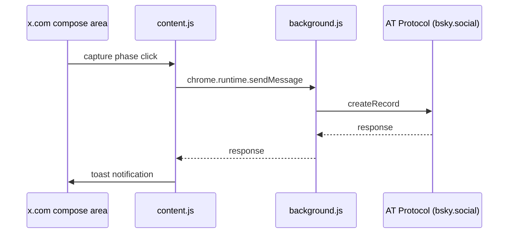

# CLAUDE.md — X to Bluesky Crossposter

## Project overview

A Chrome extension (Manifest V3) that hooks the X (Twitter) post button and posts the same text to Bluesky at the same time.
Zero external dependencies; every file is written from scratch. No API keys needed (the X side is a DOM hook, the Bluesky side talks the AT Protocol directly).

## Repository layout

```
x-to-bsky/
├── manifest.json        # Manifest V3 configuration
├── background.js        # Service worker: Bluesky API (auth, posting, images, threads)
├── lib.js               # Pure functions (grapheme handling, text splitting, facet parsing, URL detection, URL shortening)
├── shared.js            # Constants, icons and page language shared by content.js / options.js / popup.js (DEFAULT_SELECTORS, createIcon, renderIcons, UI_LANG, translate, applyMessages, ERROR_MESSAGES, errorText)
├── content.js           # Content script on x.com (post, image and thread hooks)
├── content.css          # Styles for the toast notification, badge and icons
├── popup.html           # Toolbar popup UI
├── popup.js             # Popup logic (ON/OFF toggle, i18n)
├── options.html         # Options page UI (credentials, selector settings)
├── options.js           # Options logic (credentials, selectors, i18n)
├── icons/               # 16/48/128px PNG
├── _locales/            # ja / en messages for the extension name and description (__MSG_*__ in manifest.json); default_locale is en, so any other browser language gets the English ones
├── .github/workflows/   # GitHub Actions workflows
├── build.sh             # zip packaging
├── test/lib.test.js     # Vitest unit tests (lib.js)
├── test/background.test.js # Vitest: link card fetch destinations, with background.js driven through its message listener and chrome / fetch stubbed
├── test/icons.test.js   # Vitest: the UI files contain no emoji, and the icon names they use exist in shared.js
├── test/i18n.test.js    # Vitest: popup.html / options.html / content.js use only messages that exist in Japanese and English, the pages show Japanese only as the fallback of translated elements, and every error code thrown in background.js has a message
├── test/release.test.js # Vitest: structure of the Release / Tag release workflows and the scripts in tools/
├── tools/check-tag.sh   # Release: decides whether to release from whether the run is on a tag and from the tag name
├── tools/tag-plan.sh    # Tag release: prints the tag to put on a master commit that moved the version
├── tools/verify-version.sh # Release: checks that the tag matches version / version_name in manifest.json
├── package.json         # dev dependencies (vitest)
├── PRIVACY_POLICY.md    # Privacy policy (EN; JA is PRIVACY_POLICY_JA.md)
├── README.md            # Setup steps and description of the behavior (EN; JA is README.ja.md)
└── CLAUDE.md            # This file
```

## Architecture

### Data flow



### content.js

- Hooks the capture phase with `document.addEventListener("click", handler, true)`
- Selectors are the default definitions, overridable through `chrome.storage.local.customSelectors`
- Text extraction: increments `tweetTextarea_${n}` from 0 to get the whole thread
- Image extraction: captures the `` elements near the textarea as base64 through a canvas (synchronous). Images with `object-fit: cover` are cropped to the visible area with `getVisibleRect()` before capture. The capture result includes `width`/`height`, which are sent to Bluesky as the AT Protocol `aspectRatio` field
- Fallback: `.DraftEditor-root [data-text="true"]`
- Reply detection: `isReplyContext()` detects whether the post is a reply to an existing post (in the modal, by the presence of the replied-to tweet `[data-testid="tweet"]`, with quote reposts excluded; the inline compose on a `/status/` page counts as a reply). When `postReplies` is OFF (the default), replies are not cross-posted
- A badge with the butterfly SVG icon (`createIcon("butterfly")`) is added to the post buttons dynamically with a MutationObserver. It is shown only when crossposting is ON and credentials are set, and the badges on existing buttons are also added or removed when `crosspostEnabled` / `bskyHandle` / `customSelectors` change
- A toast notification shows the result of the Bluesky post (success: blue + check SVG icon, failure: red, with the number of thread posts). The toast texts and the badge title are in Japanese or English by `UI_LANG`, and an error from background.js is shown with `errorText()`
- Initial state: read directly with `chrome.storage.local.get` (no service worker startup needed). `storage.onChanged` keeps every setting in sync in real time
- Service worker startup: `sendMessageWithWakeup()` pings with `GET_STATUS` before sending the actual message. Has a 1-second timeout fallback. Non-idempotent messages are not retried
- Extension context invalidation guard: a `chrome.runtime?.id` check prevents silent failures after a reload

### background.js

- `createSession()`: authentication + session cache. A clear error message on 401
- Errors are thrown as `CodedError` with a `code` and the API's reason as `detail`, and a failed response carries both. The extension pages turn them into Japanese or English text with `ERROR_MESSAGES` in shared.js
- `resolveMentionFacets()`: resolves mention handles → DIDs
- `uploadImage(base64Data, mimeType, accessJwt)`: uploads an image with `com.atproto.repo.uploadBlob`
- `fetchOgpMetadata(url)`: fetches OGP metadata from any URL (stream-reads only the head)
- `uploadThumbnail(imageUrl, accessJwt)`: downloads an image URL and uploads it to Bluesky. Images over 1MB are shrunk with `downscaleToJpeg` before sending (because the Bluesky lexicon limits `embed.external.thumb` to 1,000,000 bytes)
- `downscaleToJpeg(buf, contentType)`: resizes to 1000px or less with `createImageBitmap` + `OffscreenCanvas` + `convertToBlob` and re-encodes as JPEG (quality lowered step by step from 0.85 to 0.4). Works in a Service Worker too. Returns null when it cannot fit in 1MB, falling back to no thumbnail
- `fetchYouTubeOEmbed(videoUrl)`: gets the title, author and thumbnail URL from YouTube oEmbed
- `buildLinkEmbed(url, accessJwt, includeThumbnail = true)`: builds a link card (`app.bsky.embed.external`). YouTube URLs (`YOUTUBE_RE`) get the title, description and thumbnail from oEmbed, other URLs from OGP metadata. When `includeThumbnail` is false, no thumbnail is attached. The page and the thumbnail are fetched only when their URL passes `isPublicHttpUrl` and `hasHostPermission`, with `redirect: "error"` (a page or thumbnail that redirects gives no card data or thumbnail), and a thumbnail response that is not `image/*` is not uploaded
- `createPost(text, images, parent, root, sess, urlEntries)`: supports image embeds, link cards and the reply chain. `sess` is the session reused within a thread, `urlEntries` is the list of shortened URLs from `shortenUrlsInText`
- `postThread(thread)`: thread posting with URL shortening + automatic splitting + reply chain
- Message handlers: `POST_TO_BSKY`, `TEST_LOGIN`, `GET_STATUS`

### lib.js

- `segmentGraphemes(text)` / `countGraphemes(text)`: exact per-grapheme handling with `Intl.Segmenter`
- `splitText(text)`: splits text over 300 graphemes automatically at line breaks and spaces. Prevents hard cuts inside URLs
- `shortenUrlsInText(text)`: converts the URLs in text over 300 graphemes to a shortened display. Removes `http(s)://` and replaces whatever exceeds `URL_DISPLAY_LIMIT` graphemes with `...`. Returns `{ text, urlEntries }`
- `buildShortenedUrlFacets(text, urlEntries)`: generates the facets for shortened URLs. `uri` keeps the original URL
- `parseFacets(text)`: no lookbehind. Detects boundaries with `(^|\s)` and corrects the offsets
- `extractFirstUrl(text)`: finds the first URL in the text (removing trailing punctuation)
- `calcCoverRect(nw, nh, dw, dh, objectPosition)`: computes the visible-area crop for `object-fit: cover` (pure function; the same algorithm as `getVisibleRect` in content.js)
- `isPublicHttpUrl(url)`: whether a URL is http(s) with a host, as written in the URL, outside the user's machine and local network. Rejects `localhost` / `*.localhost` / `*.local`, single-label names, and IP literals in the unspecified, private, shared (CGNAT), loopback, link-local, site-local and unique-local ranges, including IPv4-mapped IPv6
- `isWebStoreUrl(url)`: whether a URL is https on a Chrome Web Store host (`WEB_STORE_HOSTS`: `chrome.google.com`, `chromewebstore.google.com`) or a subdomain of one. Chrome blocks extension requests to these whatever host permissions the extension holds, while `chrome.permissions.contains` still reports `<all_urls>` as covering them

### Credential storage

- `bskyHandle`, `bskyAppPassword`, `crosspostEnabled`, `customSelectors`, `includeQuoteUrl`, `postReplies`, `includeLinkCard` and `linkCardThumbnail` are saved in `chrome.storage.local`
- Uses an App Password (not the main password; OAuth is not used)
- `host_permissions`: `bsky.social`, `*.bsky.network`
- `optional_host_permissions`: `<all_urls>` — web access permission is granted all at once when the link card feature is enabled on the options page, and removed automatically when it is disabled. background.js checks the permission with `hasHostPermission()` at posting time and posts without a card for domains that are not permitted. `hasHostPermission()` returns false for Chrome Web Store URLs (`isWebStoreUrl`)

## Coding conventions

- No external libraries or build tools. Plain JS only
- Semicolons used; quote style is not unified (manifest is standard JSON)
- Functions have JSDoc comments

## Documentation and language

- **Override of the global CLAUDE.md's 「ドキュメント」 language rule**: this file is written entirely in English, and the README is maintained in English and Japanese, English first: `README.md` / `README.ja.md`. The pair cross-links at the top and keeps the same sections in the same order
- `PRIVACY_POLICY.md` keeps its path because the Chrome Web Store listing links to it by path (`https://raw.githubusercontent.com/semnil/x-to-bsky/master/PRIVACY_POLICY.md`). `PRIVACY_POLICY_JA.md` keeps its name because `PRIVACY_POLICY.md` points at it
- `CLAUDE.md` is English only and has no Japanese counterpart
- Commit messages and PR titles and bodies are written in English, with the Conventional Commits prefixes the history uses (`feat:` / `fix:` / `refactor:` / `docs:` / `ci:` / `chore:` / `test:`). Earlier commits written in Japanese are not rewritten

## Known limitations

- **Image capture**: capture goes through a canvas, so cross-origin images (pbs.twimg.com etc.) may fail with a tainted canvas. blob: URLs (local attachments) have no problem
- **Long URLs**: URLs in text over 300 graphemes are converted to a shortened display (`http(s)://` removed + whatever exceeds `URL_DISPLAY_LIMIT` graphemes replaced with `...`). The facet URI keeps the original URL, so the link stays clickable
- **Threads**: posts become a reply chain on Bluesky only when several posts are created at once with X's "+" button. Adding to a thread by replying to an existing post is not supported, because the corresponding parent post on Bluesky cannot be identified
- **Quote reposts**: by default only the comment text is posted. Enabling it in "Post Options" on the options page appends the X link of the quoted post to the end of the text
- **Replies**: replies to existing posts are not cross-posted to Bluesky by default. Enabling "Post replies to Bluesky" in "Post Options" on the options page cross-posts the reply text too, as an independent new post (it does not become a reply chain on Bluesky and is not tied to the post replied to on X)
- **Link cards**: for a post that contains a URL and has no image, a link card with a thumbnail is generated automatically from OGP metadata. Pages without OGP tags use the HTML `<title>` / `<meta name="description">` instead, and fall back to a card without a title if no title can be obtained. Disabled by default; web access permission is granted all at once when it is enabled on the options page (removed automatically when disabled). Domains that are not permitted are posted without a card. URLs whose host is written as localhost, a local name or a local IP address (the ones `isPublicHttpUrl` rejects) get no card data and no thumbnail, and so do pages and thumbnails that redirect. Chrome Web Store URLs (the ones `isWebStoreUrl` matches) are not fetched either, and get no card data and no thumbnail
- **Reposts**: they involve no text input, so the extension does nothing (intended)

## How to test

Automated tests (what CI runs on every push and pull request to master):

```bash
npm install   # first time only
npm test      # vitest run — lib unit tests plus the icon / i18n / workflow-structure checks
```

Manual testing in the browser:

1. Install from the Chrome Web Store, or `chrome://extensions` → Developer mode → load the folder
2. Set the Bluesky App Password on the options page → Test Connection
3. Make a test post on x.com → check the post on Bluesky
4. Post with an image → check that the image is shown on Bluesky
5. Thread post (several tweets with X's "+" button) → check that it becomes a reply chain on Bluesky too
6. Test with more than 300 characters → check that it is split automatically and posted as a thread
7. Turn it OFF in the popup → check that posting does not send anything to Bluesky
8. Reply to an existing post → by default it is not posted to Bluesky. Check that it is posted once "Post replies to Bluesky" is turned ON in the settings
9. Advanced on the options page → check that changing and resetting the selectors takes effect
10. Enable link cards in the settings → check that the permission dialog is shown and the toggle turns ON after granting
11. Test post with a URL → check that a link card with a thumbnail is shown on Bluesky
12. Test post with the URL of a page that has neither `og:title` nor an HTML `<title>` → check that a link card without a title is generated (for a page with only `<title>`, that title is used)
13. Disable link cards in the settings → check that no card is generated
14. Disable thumbnails in the settings → check that the card has only a title

## Build

```bash
chmod +x build.sh
./build.sh
# → produces x-to-bsky-v${VERSION}.zip (VERSION is read from manifest.json)
```

Merging a version-bump PR (a PR that changes only `version` / `version_name` in manifest.json) is the release. When CI succeeds on a push to master, `.github/workflows/tag-release.yaml` runs, and `tools/tag-plan.sh` compares the manifest.json of that commit and of its parent. If the version (`version_name` when present, otherwise `version`) has moved, it puts the `v<version>` tag on that commit, pushes it, and starts `release.yaml` on that tag. A push that does not move the version does nothing. If a tag with the same name exists on a different commit, it fails and does not move the tag.

`.github/workflows/release.yaml` starts only with `workflow_dispatch`, and releases when started on a tag (from `tag-release.yaml`, or by hand). Pushing a tag by hand does not start it. After the same tests as CI, it builds the zip with `build.sh`, and after uploading it, compares the file name and sha256 of the downloaded zip before creating a draft Release with the zip attached. A manual start on a branch goes as far as the comparison and does not create a Release. A prerelease tag must match `version_name` in manifest.json.
